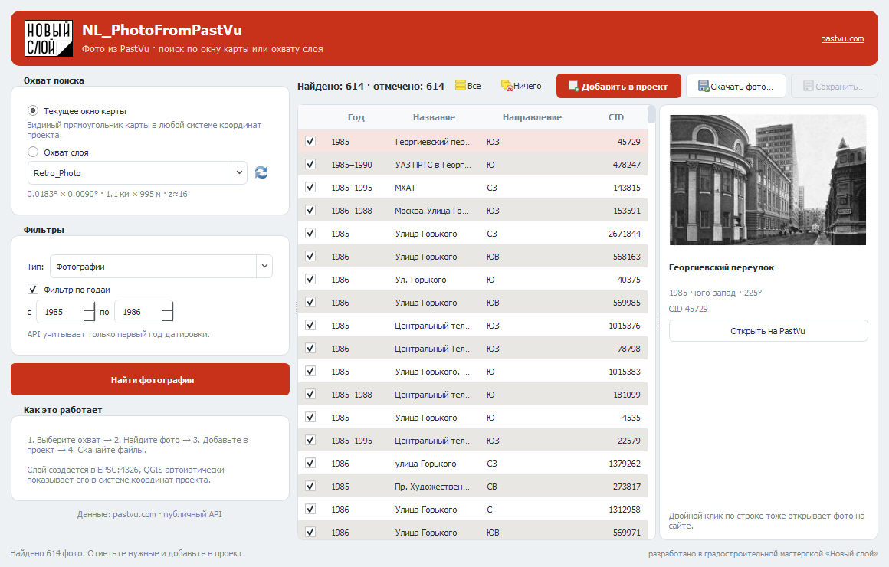
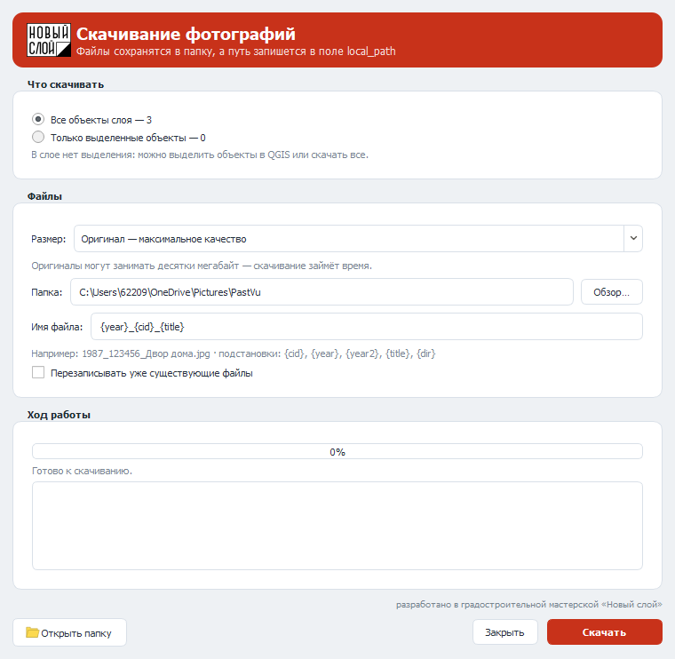

# NL_PhotoFromPastVu

Плагин QGIS для поиска и загрузки ретрофотографий с [PastVu](https://pastvu.com)
по текущему окну карты или по охвату слоя.

**English summary.** NL_PhotoFromPastVu finds historical photos on PastVu for
the current map canvas or a selected layer extent, transforms the extent to
WGS84, adds the photos as a QGIS layer and downloads the images with local
paths written to `local_path`. The plugin is developed by the New Layer urban
planning studio.



## Возможности

- **Два способа задать охват**
  - текущее окно карты;
  - экстент выбранного векторного слоя.
- **Любая система координат проекта.** Охват берётся в СК источника
  (проект или слой), плотно пересчитывается в WGS84 и отдаётся в API
  как GeoJSON.
- **Фильтры**: диапазон годов и тип объекта (фотография или картина).
- **Превью** выбранной фотографии прямо в окне.
- **Слой QGIS** с точками и атрибутами:
  `cid`, `title`, `year`, `year2`, `dir`, `azimuth`, `direction`,
  `file`, `Path`, `thumb_url`, `local_path`.
- **Стиль точек** из фирменного стиля мастерской: стрелка `N_azimuth.svg`,
  красный `#C8321A`, размер 11.5 мм и поворот по полю `azimuth`.
- **Скачивание на компьютер**: все объекты слоя или только выделенные;
  оригинал, стандартный размер или миниатюра; своя папка и шаблон имени.
  После скачивания локальные пути записываются в поле `local_path`.
- **Выделение обновляется на лету**: можно открыть окно «Скачать фото»,
  затем выделить объекты в QGIS — переключатель «Только выделенные
  объекты» сразу станет доступен.
- **Сохранение слоя**: после **Сохранить…** временный слой заменяется
  файловым прямо в дереве проекта — на том же месте и в той же группе.
  `local_path` продолжают записываться уже в файл. При сохранении в
  существующий GeoPackage другие слои файла не удаляются.
  Поддерживаются GeoPackage, GeoJSON и Shapefile.
- **Оформление**: красная шапка `#C8321A`, логотип мастерской со ссылкой
  на [newlayer.ru](https://newlayer.ru/) и подпись в правом нижнем углу.



## Установка

### Из официального репозитория QGIS

После публикации: **Модули → Управление модулями…** → найти
`NL_PhotoFromPastVu` → установить.

### Из ZIP

1. Скачайте `NL_PhotoFromPastVu-1.3.3.zip`.
2. В QGIS: **Модули → Управление модулями… → Установить из ZIP**.
3. Включите `NL_PhotoFromPastVu`.

### Вручную

Скопируйте папку `NL_PhotoFromPastVu` в каталог плагинов QGIS:

- Windows: `%APPDATA%\QGIS\QGIS3\profiles\default\python\plugins`
- Linux: `~/.local/share/QGIS/QGIS3/profiles/default/python/plugins`
- macOS: `~/Library/Application Support/QGIS/QGIS3/profiles/default/python/plugins`

Плагин появится в меню **Модули → Модули newlayer.ru → NL_PhotoFromPastVu**
и на панели инструментов.

## Как пользоваться

1. Откройте **Модули newlayer.ru → NL_PhotoFromPastVu → Поиск фотографий…**.
2. Выберите охват: «Текущее окно карты» или «Охват слоя».
3. При необходимости включите фильтр по годам и выберите тип.
4. Нажмите **Найти фотографии**.
5. Отметьте нужные строки и нажмите **Добавить в проект**.
6. Чтобы сохранить изображения, нажмите **Скачать фото…**.
7. При необходимости нажмите **Сохранить…** — файл заменит временный слой.

Двойной клик по строке результата открывает страницу фотографии на PastVu.

### Шаблон имени файла

Доступны подстановки:

- `{cid}` — номер фотографии;
- `{year}`, `{year2}` — годы датировки;
- `{title}` — название;
- `{dir}` — код направления (`n`, `ne`, …).

По умолчанию: `{year}_{cid}_{title}`. Недопустимые для Windows символы
заменяются на `_`.

## Технические детали

- API: `https://api.pastvu.com/api2`, метод `photo.getByBounds`
  с `localWork: true`.
- Запросы и скачивание выполняются в фоновых задачах `QgsTask`.
- API-ключ не требуется: публичный API PastVu работает без авторизации.
- Внешних Python-зависимостей нет, используется стандартная библиотека.
- Настройки скачивания запоминаются в `QgsSettings`.
- Плагин не блокирует интерфейс QGIS и работает в любой СК проекта.
- Ограничения API: в режиме `localWork: true` нет пагинации, поэтому
  очень большие охваты могут вернуть много объектов. Фильтр по годам
  учитывает только первый год датировки.

## Разработка

Структура:

```text
NL_PhotoFromPastVu/
├── __init__.py
├── plugin.py             # меню, панель, жизненный цикл
├── dialog.py             # главное окно
├── download_dialog.py    # окно скачивания
├── download_task.py      # QgsTask поиска и скачивания
├── layer_builder.py      # слой, поля, стиль, сохранение
├── api.py                # клиент PastVu API
├── geo.py                # охват → GeoJSON WGS84
├── config.py             # константы и QgsSettings
├── ui.py                 # QSS, иконки, кликабельный логотип
├── assets/               # логотип и SVG-стрелка
├── docs/                 # скриншоты
├── metadata.txt
├── LICENSE
└── README.md
```

Код совместим с QGIS 3.22+ (Qt5). Для QGIS 4/Qt6 часть API имеет
совместимые обёртки, но полноценное тестирование на Qt6 не проводилось.

## Лицензия

GPL-2.0. См. [LICENSE](LICENSE).
Данные и изображения принадлежат PastVu и их авторам.

## Автор

Данил Марзаев, главный архитектор проектов Градостроительной мастерской «Новый слой» · [newlayer.ru](https://newlayer.ru/) · [newlayer@ro.ru](mailto:newlayer@ro.ru)
